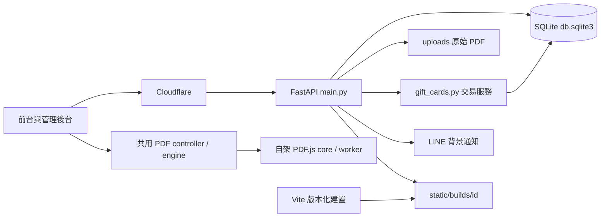

# 系統架構基準

盤點日期：2026/10/12（Asia/Taipei）；既有來源版本 `8371b83687c4e69c2dbefdc1017ad838c99a1eda`。此文件是目前有效設計，功能驗收在 `openspec/specs/`，歷史取捨在 `docs/CHANGELOG_REVIEW.md`。

## 目的及執行環境

學校 PDF 列印收件、計價、進度查詢、管理員收款與禮物卡折抵。使用者不需會員；管理員使用瀏覽器原生 HTTP Basic Auth，沒有獨立帳號登入／登出 API。實際列印由管理員操作印表機，本系統沒有印表機驅動或自動出紙功能。

前端為原生 HTML/CSS/ES Modules、Material 3 風格自訂元件及共用 `<dialog>`；Vite 8.1.5 多頁建置。PDF.js 5.7.284 自架於版本化路徑。後端為 FastAPI、Pydantic Settings、SQLAlchemy 2、pypdf、SQLite WAL、APScheduler，部署以單一 Uvicorn worker＋PM2 在 Linux/GCP 免費主機運行，Cloudflare 負責反向代理與分層快取。

## 目錄與責任

| 來源 | 責任及依賴 |
| --- | --- |
| `index.html`、`style.css`、`static/js/app.js` | 前台入口、分頁、主題、公告、SW 註冊；協調 upload/history/preview |
| `admin.html`、`admin.css`、`static/js/admin/app.js` | 後台入口，協調 orders/announcements/pdf-modal/gift-cards |
| `static/material-common.css` | 前後台共用 M3 token、六組配色與 `html.dark`、`.hidden`、對話框與焦點／減少動態政策；style.css 與 admin.css 都 `@import` 它 |
| `static/js/upload.js` | 最多 5 份本地 PDF、依序頁數解析、設定、試算、依序 multipart 上傳與重試 |
| `static/js/history.js`、`gift-card.js` | 姓名查詢分頁、唯讀進度；禮物卡套用查詢及過期回應防護 |
| `static/js/api.js`、`utils.js` | 共用 HTTP／XHR 進度與錯誤格式、HTML escaping、日期及 debounce |
| `static/dialog.js`、`static/js/dialog-api.js`、`motion.js` | 共用 ESM 對話框與有序動畫，功能模組不反向 import 入口 |
| `pdf-preview-controller.js`、`pdf-engine.js`、`pdf-paper.js` | 共用前後台 PDF 生命週期、modern/legacy 延遲載入、紙張幾何與記憶體限制 |
| `static/pdfjs/5.7.284/` | 官方 core／worker／CMap／fonts／WASM／ICC；不當成應用業務程式重寫 |
| `sw.js`、`service-worker-registration.js` | HTML network-first、版本資源 cache-first、容量限制及更新接管 |
| `main.py` | 路由、授權、限流、上傳、Range、序列化、安全快取標頭、排程及健康檢查 |
| `gift_cards.py` | 注入 auth／rate-limit 建立 router，收款／發卡／折抵／取消；不可 import main |
| `database.py`、`schemas.py`、`config.py` | ORM 與增量遷移、請求驗證、集中設定。database 只依賴 config |
| `compression.py`、`compressed_static.py` | 壓縮協商、ETag 與 sidecar 派發；後者依賴前者 |
| `notify.py`、`log_manager.py` | LINE 傳送、Zstd 日誌輪替；notify 目前仍自行讀 .env，見技術債 |
| `precompress.py`、`vite.config.mjs`、`scripts/verify-build.mjs` | 正式預壓縮、版本建置、內容／資源預算驗證 |
| `deploy.sh`、`ecosystem.config.cjs`、`setup_free_tier.sh` | Linux 部署／回復、PM2 單 worker、主機初始化；初始化品質系統不執行正式部署 |
| `tests/`、`quality/`、`scripts/quality-*`、`docs/`、`openspec/` | 回歸、契約與依賴基準、報告、規格與持久上下文 |

## 資料流與不可破壞的約束

1. 本地 PDF 先由瀏覽器 PDF.js 取得頁數；解析失敗才送 `/api/check-pages`，不得猜 `/Count` 或預設 2 頁。前端只試算；後端以 pypdf 的頁數乘黑白 1／彩色 2 元計價，單雙面／fit／cover／裝訂不改單價。
2. `/api/upload` 先逐塊驗證副檔名、大小、magic，寫同目錄 `.part`，限制 PDF 解析併發，成功後原子改名，再以交易建立訂單及折抵。未提交失敗清除檔案並 rollback。檔案與 SQLite 是兩種儲存，斷電一致性仍有待改進，不能宣稱跨儲存完全 ACID。
3. 金額為新台幣整數，`amount_due = max(0, total_price - gift_card_discount)`。SQLite `BEGIN IMMEDIATE` 必須先於讀取餘額／收款狀態；UUID request_id＋內容指紋＋收據與扣款在同一交易。不能把重送當新交易或解除財務狀態保護。
4. 管理員實收不足拒絕，剛好不發卡，多付差額自動發卡。取消未列印訂單只退折抵至原卡，現金退款另行處理，原多付款發出的卡保留。刪除／清理不退款，帳目／收據不得隨訂單刪除。
5. 原始 PDF 不轉圖、不改寫；fit／cover 為前端預覽與列印偏好。遠端 PDF 支援 200／206／416 Range，使用者預覽驗證姓名、管理下載驗證 Basic Auth。
6. 主頁原始碼或版本化 Vite HTML依 APP_BUILD_ID 選擇。正式模式缺少匹配產物拒絕啟動；`/health` 同時回報後端與前端版本。PDF 引擎不可進入初始 bundle，初始 JS/CSS 最多 4 個請求、100 KiB Brotli。

## API 與資料模型

完整機器可比對基準在 `tests/fixtures/contracts.json`，涵蓋 OpenAPI 與 ORM 資料欄位／索引／約束；具體行為仍需整合測試驗證。

| 方法／路徑 | 授權、輸入與输出 |
| --- | --- |
| GET/HEAD `/`；GET `/sw.js`；GET `/health` | 公開；HTML、SW、`{status,db,uptime_seconds,version,build_id,frontend_build_id}` |
| GET `/admin` | 管理員 Basic Auth；沒有前端第二次登入 |
| POST `/api/check-pages` | multipart PDF；`{pages}`，錯誤 400／413／422 |
| POST `/api/upload` | multipart 檔案／姓名／列印設定／取件時間／可選卡及 UUID；201 回 order_id、原價、折抵、應付及卡餘額 |
| GET `/api/orders/history` | user_name，選填 page/page_size；無 page 的舊陣列保留，上限 200；新格式為 items/total/page/page_size/total_pages |
| GET `/api/orders`；PUT/DELETE `/api/orders/{id}` | 管理員列表／付款與列印狀態更正／刪除。分頁格式另含全庫 `summary`（未付款／待列印），選填 `q` 依姓名或編號搜尋；財務紀錄限制不可繞過 |
| GET `/api/orders/{id}/file[/{file_name}]` | 管理員原檔串流；URL 檔名不控制實體檔案路徑 |
| GET `/api/orders/{id}/preview[/{file_name}]` | user_name 驗證原檔串流；姓名是既有弱識別，非會員授權 |
| GET/HEAD `/api/announcements` | 公開啟用公告，五分鐘公開快取 |
| GET `/api/admin/announcements`；POST/PUT/DELETE `/api/announcements[/{id}]` | 管理員列表／新增／修改／刪除；內容經 Pydantic trim、非空、1000 字限制 |
| POST `/api/gift-cards/check` | 卡代碼只放 body；公開只回餘額與啟用狀態 |
| GET `/api/admin/gift-cards`；POST `.../search`；GET/PUT `.../{id}` | 管理員分頁、精確代碼搜尋、明細／啟停 |
| POST `/api/admin/orders/{id}/payment`；`.../cancel` | 管理員 UUID 冪等收款／取消及退款摘要 |

SQLite 表：`orders`（姓名、檔名／實體路徑、頁數、原價、列印偏好、取件時間、付款／列印、finance_key、gift_card_id／discount、cash_received、is_cancelled、時間）；`announcements`；`gift_cards`（唯一代碼、初額／餘額、啟停、來源訂單、備註）；`gift_card_transactions`（issue/redeem/refund、signed amount、balance_after、獨立訂單摘要／key）；`operation_receipts`（request_id PK、fingerprint、response_json）。財務關聯刻意不設刪除 cascade。時間為台北 naive datetime；啟動時 create_all＋可重複新增欄位／索引，沒有 downgrade 遷移。

## 快取與安全邊界

無 query 的版本 build／PDF.js 以一年 immutable；首頁瀏覽器 no-cache、edge 一小時＋SWR；公告五分鐘；SW no-cache／edge no-store。帶 Authorization、錯誤、後台、API（公告例外）、PDF、health 皆 no-store；未版本化來源只開發 fallback。SW 跳過 API、後台、認證、query 版本變體及使用者 PDF。

Basic Auth constant-time 比對、失敗鎖定、IP 滑動視窗限流與可信代理 CIDR是既有防護。預設帳密、姓名預覽、反代 IP 設定、CSP 外部來源需依 `docs/KNOWN_ISSUES.md` 後續安全審查，測試不代表正式設定已確認。

## 依賴及演進規則

JS 由 `.dependency-cruiser.cjs` 檢查無循環／未解析引用、功能不 import 入口、共用核心不依賴 UI、前台不依賴後台。Python 用 AST 檢查所有根目錄模組的 import（含函式內引用）與 `quality/python-boundaries.json`，不執行業務初始化。新增模組需審查並同步規格與邊界。

現有程式未採前端框架、獨立服務或 PostgreSQL。此輪不導入全域 ESLint／型別重構、Beads、微服務或架構豁免；語法、依賴、契約、pytest、Node tests、Playwright、建置驗證是漸進防護。孤立模組為警告；相似邏輯、無用 export 與文件语意一致性仍需人工審查。
